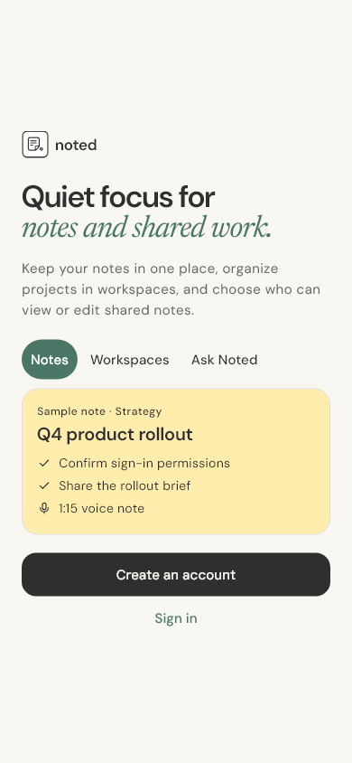
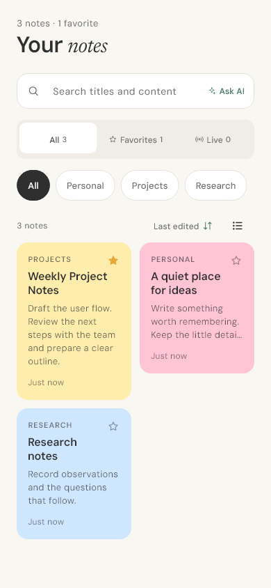
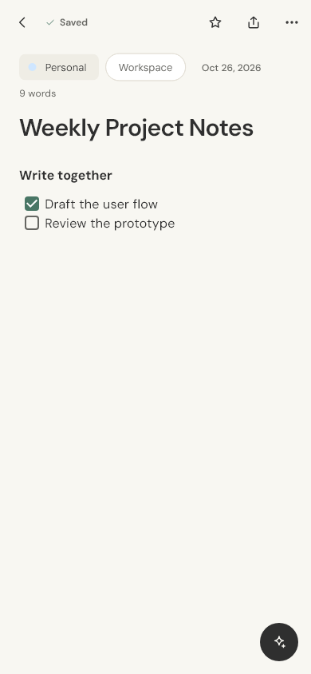
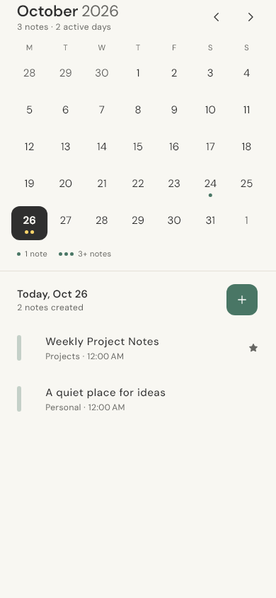
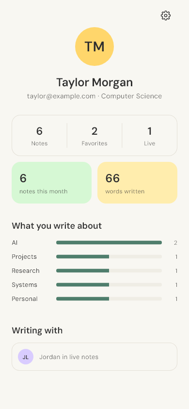
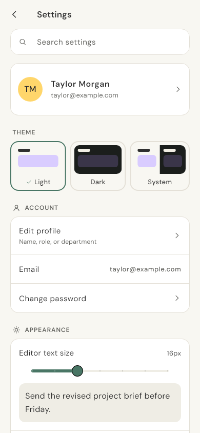
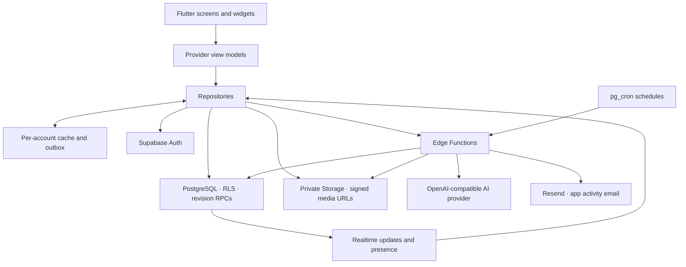

<h1 align="center">Noted</h1>

<p align="center">
  A peaceful space for personal ideas and shared work.
</p>

<p align="center">
  <a href="https://github.com/deserveto/noted/releases/tag/v2.0.0">Download for Android</a> &nbsp;·&nbsp;
  <a href="CHANGELOG.md">What's new in 2.0.0</a> &nbsp;·&nbsp;
  <a href="https://github.com/deserveto/noted/issues/new/choose">Report an issue</a>
</p>

<p align="center">
  
</p>

<p align="center">
  <a href="#a-look-inside">Screenshots</a> &nbsp;·&nbsp;
  <a href="#what-you-can-do">Features</a> &nbsp;·&nbsp;
  <a href="#run-it-locally">Quick start</a> &nbsp;·&nbsp;
  <a href="#how-it-fits-together">Architecture</a> &nbsp;·&nbsp;
  <a href="#documentation">Documentation</a>
</p>

Noted is a Flutter app for everyday notes and work you share with others. Keep meeting notes beside a sketch or voice memo, organize research into personal workspaces, and invite someone to edit with you. Noted AI can answer questions about selected notes or turn them into flashcards you can save for later.

The interface uses warm paper colors, sage accents, and bundled DM Sans with Newsreader italic. Supabase handles authentication, live updates, and private media. Android is the verified build target; see [release readiness](#release-readiness) for the remaining deployment and device checks.

## A look inside

These are real Flutter golden renders with sample data. Each preview follows your GitHub light or dark theme; [all full-size renders](test/goldens/) are in the repository.

<table>
  <tr>
    <th width="33%">Welcome</th>
    <th width="33%">Notes library</th>
    <th width="33%">Rich-text editor</th>
  </tr>
  <tr>
    <td align="center"><picture><source media="(prefers-color-scheme: dark)" srcset="test/goldens/welcome_390_dark.png" /></picture></td>
    <td align="center"><picture><source media="(prefers-color-scheme: dark)" srcset="test/goldens/library_390_dark.png" /></picture></td>
    <td align="center"><picture><source media="(prefers-color-scheme: dark)" srcset="test/goldens/editor_390_dark.png" /></picture></td>
  </tr>
  <tr>
    <th>Calendar</th>
    <th>Profile</th>
    <th>Settings</th>
  </tr>
  <tr>
    <td align="center"><picture><source media="(prefers-color-scheme: dark)" srcset="test/goldens/calendar_390_dark.png" /></picture></td>
    <td align="center"><picture><source media="(prefers-color-scheme: dark)" srcset="test/goldens/profile_390_dark.png" /></picture></td>
    <td align="center"><picture><source media="(prefers-color-scheme: dark)" srcset="test/goldens/settings_390_dark.png" /></picture></td>
  </tr>
</table>

The layouts adapt to different phone widths and include light, dark, and system themes. Color, type, and component details are in the [design system](DESIGN.md).

## What you can do

| | In Noted |
|---|---|
| Writing | Rich text, headings, lists, and checklists in a Quill editor. Existing Markdown stays readable and imports without a destructive bulk rewrite. |
| Organization | Categories, colors, favorites, title and content search, calendar dates, and personal workspaces. Restore notes from Recently deleted before the scheduled 30-day purge. |
| Collaboration | Live editing with edit or view roles, collaborator presence, revision-checked saves, and access revocation. Send independent note copies to accepted connections. |
| Attachments | Add images, drawings, and voice memos. Attachments and avatars use private Storage; copied notes receive independent media paths. |
| Offline work | A cache and pending-write outbox for each account. Edits replay on reconnect, and conflict handling preserves recovery drafts. |
| Noted AI | Ask about selected notes, follow validated sources, work with structured answers, edit selected text, and save flashcards as study decks. Includes cancellation, feedback, and chat history. |
| Account and preferences | App lock, writing preferences, profile photos, password recovery, JSON export, and account deletion. Optional analytics is off by default. |
| Connections and activity | Email connection requests, an in-app activity feed, quiet hours, and scheduled recaps. Outbound email requires a configured provider. |

AI answers are validated after generation and delivered as complete responses. AI and email providers run on the server and have their own availability and usage limits. JSON exports include available workspace and study-deck data; attachment files and automatic restore are not included.

## Run it locally

### 1. Get the project

Use Flutter 3.41.6 with Dart 3.11.4, an Android SDK, and Java 17. Backend tests and migration tools need Node.js 22+. The Android build uses AGP 8.13.2, Gradle 8.13, and Kotlin 2.3.10. Keep the committed lockfiles to reproduce this environment.

```powershell
git clone https://github.com/deserveto/noted.git
Set-Location noted
flutter doctor
flutter pub get
```

### 2. Connect a Supabase backend

Follow the [backend setup guide](docs/SUPABASE_SETUP_AND_CUTOVER.md) to provision the schema, private buckets, and matching Edge Functions before launching the app.

Create the ignored client configuration once. The commands here use PowerShell:

```powershell
if (-not (Test-Path .env.supabase.json)) {
  Copy-Item .env.supabase.example.json .env.supabase.json
}
```

Fill in `.env.supabase.json` with your project's public client values:

```json
{
  "SUPABASE_URL": "https://YOUR_PROJECT_REF.supabase.co",
  "SUPABASE_ANON_KEY": "YOUR_SUPABASE_PUBLISHABLE_OR_ANON_KEY",
  "NOTED_AUTH_REDIRECT_URL": "noted://app/auth-callback"
}
```

`SUPABASE_PUBLISHABLE_KEY` is also supported and takes precedence over `SUPABASE_ANON_KEY`. Publishable and anon keys rely on Row Level Security (RLS) policies to protect data. Keep service-role keys, database passwords, signing passwords, and AI or email secrets outside the app and Git. See [Supabase's key guidance](https://supabase.com/docs/guides/api/api-keys).

### 3. Launch on Android

Start an emulator or connect an Android device:

```powershell
flutter devices
flutter run --dart-define-from-file=.env.supabase.json
```

The unit, widget, and golden tests can run without live Supabase credentials. The connected app needs the backend above.

## How it fits together

Noted uses MVVM with Provider. Views render state, view models coordinate it, and repositories own backend access. Direct database and media access use RLS; Edge Functions revalidate user access. Stored `noted-media://` references stay stable while signed media URLs expire. Scheduled maintenance uses a separate cron secret.

<details>
<summary>Architecture diagram</summary>



</details>

<details>
<summary>Repository structure</summary>

```text
lib/
├── models/          Data models and PostgreSQL/JSON mapping
├── repositories/    Auth, notes, AI, connections, settings, activity
├── services/        Supabase, media, collaboration, offline, app lock
├── viewmodels/      Provider state and application coordination
├── views/           Screens and routes
├── widgets/         Shared interface and rich-note components
└── utils/           Theme, document codec, links, validation, OT
supabase/
├── migrations/      Versioned schema, RLS, RPCs, storage, schedules
├── functions/       Five Deno Edge Functions
└── tests/           SQL/RLS, handler, and migration regression suites
test/                Flutter unit/widget/golden and integration-style tests
tools/migration/     Optional legacy data export/import/validation
docs/                Setup, review evidence, design and migration history
functions/           Historical Firebase reference; not the active backend
```

</details>

See the [backend overview](supabase/README.md) for deployment responsibilities and trust boundaries. Version 2.0.0 combines the interface rebuild and Firebase-to-Supabase migration merged in [PR #50](https://github.com/deserveto/noted/pull/50).

## Verification

[GitHub Actions](https://github.com/deserveto/noted/actions/workflows/ci.yml) runs Flutter analysis and tests, backend tests, and Edge Function type checks.

```powershell
# Flutter: static analysis, unit/widget/golden coverage
flutter pub get
flutter analyze
flutter test

# PostgreSQL/RLS, Edge handlers, and migration tooling
Set-Location tools/migration
npm ci
npm test
Set-Location ../..

# Edge Function types (requires Deno)
deno check supabase/functions/account/index.ts supabase/functions/connections/index.ts supabase/functions/note-sharing/index.ts supabase/functions/noted-ai/index.ts supabase/functions/scheduled-maintenance/index.ts

# Release build: configure android/key.properties first
flutter build apk --release --dart-define-from-file=.env.supabase.json
```

The APK is written to `build/app/outputs/flutter-apk/app-release.apk`. Release builds require an upload keystore and ignored `android/key.properties`, with no debug-signing fallback. Follow the [signing and release instructions](docs/SUPABASE_SETUP_AND_CUTOVER.md#7-android-signing-and-final-gates) and preserve the existing published signing identity.

Golden fixtures cover light and dark layouts at 360, 390, and 430 px. Backend tests use PGlite and controlled handler and provider fixtures. A passing local suite or workflow still needs acceptance checks against the deployed backend and physical devices.

## Release readiness

The open-enrollment Android beta updater is available in version `2.0.1` (build `4`). The first updater-enabled APK is a public bootstrap prerelease; install it, then create a Noted account or sign in. Later in-app downloads are authorized for every signed-in account and use short-lived links to private storage. See the [beta release runbook](docs/beta-releases.md) and [release verification record](docs/releases/2026-11-05-beta-2.0.1-build-4.md). Android requires users to finish installation; do not uninstall as a routine update step.

The November 1, 2026 release notes record the following outstanding checks. Use the [setup and cutover guide](docs/SUPABASE_SETUP_AND_CUTOVER.md) when preparing a public rollout.

| Area | Remaining checks |
|---|---|
| Backend | All 13 local migrations matched the linked project's history. The `noted-ai`, `note-sharing`, and `account` handlers were deployed and verified against this candidate. Complete authenticated end-to-end acceptance in the target environment. |
| Auth email | Verify actual Gmail SMTP delivery and enable email confirmation before public rollout. Saved settings alone do not confirm delivery. |
| Activity email | Verify the separate Resend sender used for invitations and recaps. |
| Devices | Check two-device editing, offline reconnect, access revocation, microphone and camera, biometrics, and external auth and note links from a cold start. |
| Recovery | Confirm recoverable database and media backups and test restoration. The last recorded physical-backup listing contained no backup records. |

The [combined review](docs/FULL_CHANGE_REVIEW.md) records the fixes and verification limits behind PR #50.

## Documentation

| To… | Start here |
|---|---|
| Provision a backend or prepare a release | [Supabase setup & cutover](docs/SUPABASE_SETUP_AND_CUTOVER.md) |
| Understand backend access and deployment | [Backend overview](supabase/README.md) |
| Work on colors, typography, or components | [Design system](DESIGN.md) |
| Review the combined UI and backend changes | [Full change review](docs/FULL_CHANGE_REVIEW.md) · [PR #50](https://github.com/deserveto/noted/pull/50) |
| Import historical Firebase data | [Migration tooling](tools/migration/README.md) |
| Find plans and audit evidence | [Documentation index](docs/README.md) |
| Understand the remaining Firebase files | [Legacy backend reference](functions/README.md) |

## Reporting issues

Use the [issue forms](https://github.com/deserveto/noted/issues/new/choose) to [report a bug](https://github.com/deserveto/noted/issues/new?template=01-bug-report.yml) or [request a feature](https://github.com/deserveto/noted/issues/new?template=02-feature-request.yml). Search [existing issues](https://github.com/deserveto/noted/issues) first so related reports stay together.

For bugs, include the steps to reproduce, expected and actual behavior, app version, and device details. Screenshots and logs help when they show the problem; remove credentials, email addresses, and private note content before posting. If you built the app yourself, include the commit and relevant toolchain details.

## Contributing

Start from `main`, keep changes focused, and include verification results in your pull request. Follow the MVVM and Provider boundaries and the [repository instructions](AGENTS.md). For UI changes, read [DESIGN.md](DESIGN.md), inspect light and dark layouts, and review golden changes as images. For backend changes, add a versioned migration and test access control and concurrency behavior.

This repository does not currently include a root software license. Bundled fonts retain their own [DM Sans](assets/fonts/DMSans-LICENSE.txt) and [Newsreader](assets/fonts/Newsreader-LICENSE.txt) licenses.
