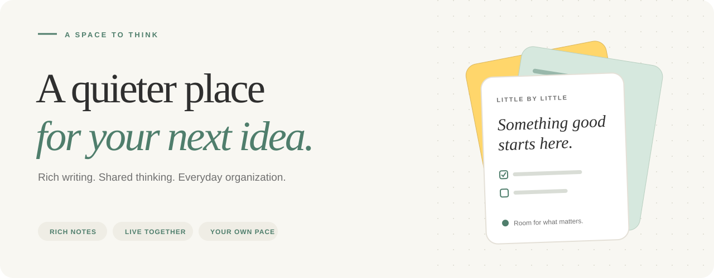
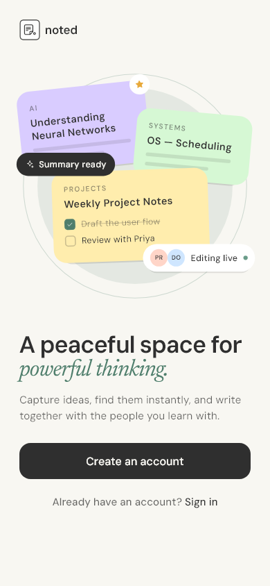
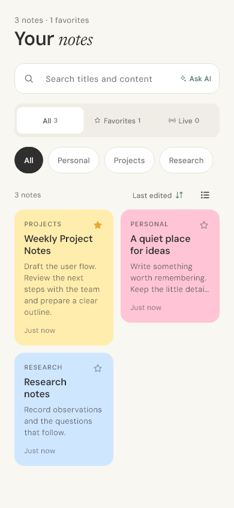
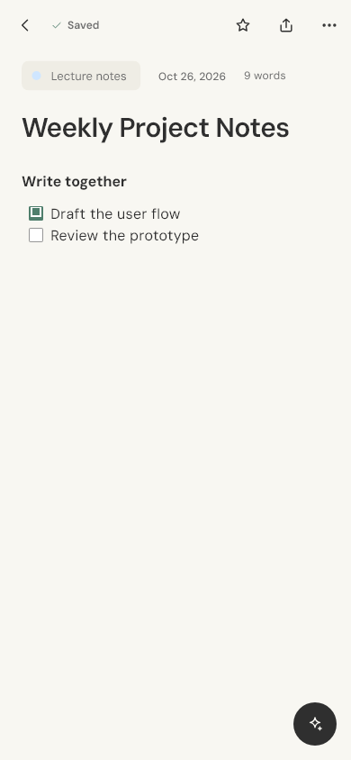
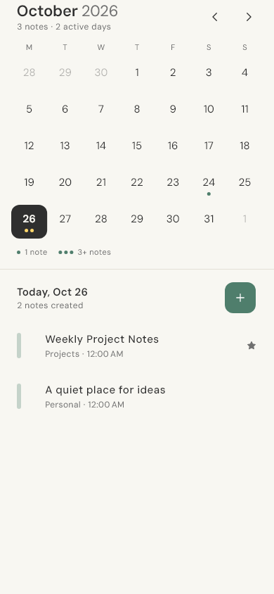
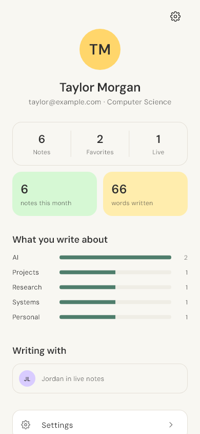
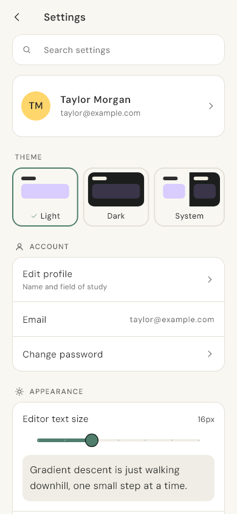
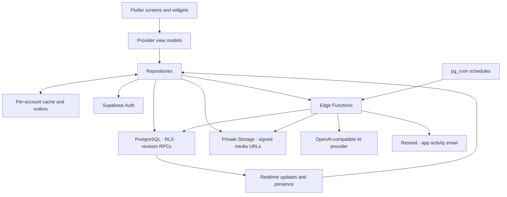

<p align="center">
  
</p>

<h1 align="center">Noted</h1>

<p align="center">
  A peaceful space for personal ideas and shared work.<br />
  Rich notes, live collaboration, and a little help from AI.
</p>

<p align="center">
  <a href="https://github.com/deserveto/noted/releases/tag/v2.0.0"></a>
  <a href="https://flutter.dev"></a>
  <a href="supabase/README.md"></a>
  <a href="#verification"></a>
</p>

<p align="center">
  <a href="#a-look-inside">Screenshots</a> &nbsp;·&nbsp;
  <a href="#what-you-can-do">Features</a> &nbsp;·&nbsp;
  <a href="#run-it-locally">Quick start</a> &nbsp;·&nbsp;
  <a href="#how-it-fits-together">Architecture</a> &nbsp;·&nbsp;
  <a href="#documentation">Documentation</a>
</p>

<picture>
  <source media="(prefers-color-scheme: dark)" srcset="docs/assets/readme-hero-dark.svg" />
  
</picture>

## Make room for the things worth keeping

Capture a thought before it disappears. Turn a meeting into a shared working note. Gather research, a drawing, or a voice memo in the same place. Noted pairs a warm, uncluttered Flutter interface with a Supabase backend built around account isolation and private media.

**Android is the verified target in this repository. v2.0.0 is a pre-release.** It brings together the UI rebuild and Firebase-to-Supabase migration from [PR #50](https://github.com/deserveto/noted/pull/50). Backend deployment and physical-device acceptance are separate release steps; read [release readiness](#release-readiness) before using a build.

<p align="center">
  <a href="https://github.com/deserveto/noted/releases/tag/v2.0.0"><strong>Get the v2.0.0 Android pre-release →</strong></a>
  &nbsp;·&nbsp;
  <a href="CHANGELOG.md">What's new</a>
</p>

## A look inside

Real Flutter golden renders, using fixture data. Screenshots follow your GitHub light/dark preference. Full-size images are in [test/goldens/](test/goldens/).

<table>
  <tr>
    <th width="33%">A calm beginning</th>
    <th width="33%">Your notes, organized</th>
    <th width="33%">Space to write</th>
  </tr>
  <tr>
    <td align="center"><picture><source media="(prefers-color-scheme: dark)" srcset="test/goldens/welcome_390_dark.png" /></picture></td>
    <td align="center"><picture><source media="(prefers-color-scheme: dark)" srcset="test/goldens/library_390_dark.png" /></picture></td>
    <td align="center"><picture><source media="(prefers-color-scheme: dark)" srcset="test/goldens/editor_390_dark.png" /></picture></td>
  </tr>
  <tr>
    <th>Plan by date</th>
    <th>A personal overview</th>
    <th>Make it yours</th>
  </tr>
  <tr>
    <td align="center"><picture><source media="(prefers-color-scheme: dark)" srcset="test/goldens/calendar_390_dark.png" /></picture></td>
    <td align="center"><picture><source media="(prefers-color-scheme: dark)" srcset="test/goldens/profile_390_dark.png" /></picture></td>
    <td align="center"><picture><source media="(prefers-color-scheme: dark)" srcset="test/goldens/settings_390_dark.png" /></picture></td>
  </tr>
</table>

The interface uses bundled **DM Sans** and **Newsreader italic**, a sage-and-paper palette, semantic light/dark colors, and responsive layouts. [Explore the design system →](DESIGN.md)

## What you can do

| | In Noted |
|---|---|
| **Write naturally** | Rich text, headings, lists, and checklists in a Quill editor. Existing Markdown stays readable and imports without a destructive bulk rewrite. |
| **Find your rhythm** | Categories, note colors, favorites, title/content search, calendar dates, and a recently deleted area with restore. |
| **Think together** | Live edit/view roles, collaborator presence, revision-checked saves, and access revocation. Share independent note copies with accepted connections. |
| **Keep the context** | Images, drawings, voice memos, and avatars in private Storage. Copies receive independent media paths. |
| **Keep going offline** | A per-account cache and pending-write outbox replay edits on reconnect; conflict handling preserves recovery drafts. |
| **Ask your notes** | Note-scoped AI answers with validated sources, structured blocks, flashcards, cancellation, feedback, and chat history. |
| **Stay in control** | App lock, theme and writing preferences, account export/deletion, and optional analytics disabled by default. |
| **Stay connected** | Email connection requests, an in-app activity feed, quiet hours, and scheduled recap support. Outbound email needs a configured provider. |

AI responses are validated after generation rather than streamed token by token. AI and email providers are configured on the server; availability and provider usage limits apply.

## Run it locally

### 1. Get the project

Use **Flutter 3.41.6 / Dart 3.11.4**, an Android SDK, and **Java 17**. **Node.js 22+** is needed for backend tests and migration tools. Android uses AGP 8.13.2, Gradle 8.13, and Kotlin 2.3.10; retain the committed lockfiles to reproduce the verified build.

```powershell
git clone https://github.com/deserveto/noted.git
Set-Location noted
flutter doctor
flutter pub get
```

### 2. Connect a Supabase backend

Provision the schema, private buckets, and matching Edge Functions using the [backend setup guide](docs/SUPABASE_SETUP_AND_CUTOVER.md). An empty Supabase project with only a URL/key is not sufficient.

Create the ignored client configuration once. These examples use PowerShell:

```powershell
if (-not (Test-Path .env.supabase.json)) {
  Copy-Item .env.supabase.example.json .env.supabase.json
}
```

Edit `.env.supabase.json` with your project's **public client values**:

```json
{
  "SUPABASE_URL": "https://YOUR_PROJECT_REF.supabase.co",
  "SUPABASE_ANON_KEY": "YOUR_SUPABASE_PUBLISHABLE_OR_ANON_KEY",
  "NOTED_AUTH_REDIRECT_URL": "noted://app/auth-callback"
}
```

`SUPABASE_PUBLISHABLE_KEY` is also supported and takes precedence over `SUPABASE_ANON_KEY`. Client keys do not replace RLS. Service-role keys, database passwords, signing passwords, and AI/email secrets belong outside the app and Git.

### 3. Launch on Android

Start an emulator or connect an Android device, then run:

```powershell
flutter devices
flutter run --dart-define-from-file=.env.supabase.json
```

The unit/widget/golden suite can run without live Supabase credentials. Running the connected app requires the backend configuration above.

## How it fits together



Views render state; view models coordinate it; repositories own backend access. Direct database and media access use RLS. Edge Functions revalidate user access; scheduled maintenance uses a separate cron secret. Signed media URLs expire, while stored `noted-media://` references remain stable.

```text
lib/
├── models/          Data models and PostgreSQL/JSON mapping
├── repositories/    Auth, notes, AI, connections, settings, activity
├── services/        Supabase, media, collaboration, offline, app lock
├── viewmodels/      Provider state and application coordination
├── views/           Screens and routes
├── widgets/         Shared interface and rich-note components
└── utils/           Theme, document codec, links, validation, OT
supabase/
├── migrations/      Versioned schema, RLS, RPCs, storage, schedules
├── functions/       Five Deno Edge Functions
└── tests/           SQL/RLS, handler, and migration regression suites
test/                Flutter unit/widget/golden and integration-style tests
tools/migration/     Optional legacy data export/import/validation
docs/                Setup, review evidence, design and migration history
functions/           Historical Firebase reference; not the active backend
```

For backend deployment responsibilities, see [supabase/README.md](supabase/README.md).

## Verification

The merged source was reverified on **October 28, 2026**: **89 backend tests**, **115 Flutter tests**, **zero analysis issues**, all five Deno entry-point checks, and a signed **63.7 MB Android release APK**. These are local results, not GitHub Actions status; this repository currently has no CI workflow.

```powershell
# Flutter: static analysis, unit/widget/golden coverage
flutter pub get
flutter analyze
flutter test

# PostgreSQL/RLS, Edge handlers, and migration tooling
Set-Location tools/migration
npm ci
npm test
Set-Location ../..

# Edge Function types (requires Deno)
deno check supabase/functions/account/index.ts supabase/functions/connections/index.ts supabase/functions/note-sharing/index.ts supabase/functions/noted-ai/index.ts supabase/functions/scheduled-maintenance/index.ts

# Release build: configure android/key.properties first
flutter build apk --release --dart-define-from-file=.env.supabase.json
```

The APK is written to `build/app/outputs/flutter-apk/app-release.apk`. Release builds require an upload keystore and ignored `android/key.properties`; there is no debug-signing fallback. Follow the [signing and release instructions](docs/SUPABASE_SETUP_AND_CUTOVER.md#7-android-signing-and-final-gates), preserving any existing published signing identity.

Golden fixtures cover 360, 390, and 430 px light/dark layouts. The backend suite uses PGlite and controlled handler/provider fixtures; it does not replace testing a deployed project or physical devices.

## Release readiness

Source merge, backend deployment, and public release are separate milestones. **The following remain open at this documentation update:**

- **Backend rollout:** deploy migration 11 and the matching AI/sharing functions together. The last recorded live state has migrations 1–10 and the earlier function sources; merging Git does not deploy Supabase.
- **Auth email:** Gmail SMTP settings are saved, but actual delivery needs verification and email confirmation needs enabling before public rollout.
- **Activity email:** invitations and recaps use a separate Resend sender that still needs verification.
- **Device acceptance:** check two-device editing, offline/reconnect and revocation, microphone/camera, biometrics, and external cold-start auth/note links.

The [setup and cutover guide](docs/SUPABASE_SETUP_AND_CUTOVER.md) is the operational checklist. [The combined review](docs/FULL_CHANGE_REVIEW.md) records the fixes, evidence, and limits behind PR #50.

## Documentation

| I want to… | Start here |
|---|---|
| Provision, deploy, or prepare a release | [Supabase setup & cutover](docs/SUPABASE_SETUP_AND_CUTOVER.md) |
| Understand the backend and its trust boundaries | [Backend overview](supabase/README.md) |
| Understand the UI's colors, type, and components | [Design system](DESIGN.md) |
| Review the combined UI/backend changes | [Full change review](docs/FULL_CHANGE_REVIEW.md) · [PR #50](https://github.com/deserveto/noted/pull/50) |
| Import historical Firebase data | [Migration tooling](tools/migration/README.md) |
| Find historical plans and audit evidence | [Documentation index](docs/README.md) |
| Understand why Firebase files remain | [Legacy backend reference](functions/README.md) |

## Contributing

Start from `main`, keep changes focused, and include verification results in your pull request. Follow the existing MVVM/Provider boundaries and [repository instructions](AGENTS.md). For UI changes, read [DESIGN.md](DESIGN.md), inspect light/dark layouts, and review golden changes as images. For backend changes, add a versioned migration and test access control and concurrency behavior.

Report reproducible bugs through [GitHub Issues](https://github.com/deserveto/noted/issues), including steps, expected/actual behavior, and toolchain details. Remove credentials and personal note content from examples. This repository does not currently include a root software license; bundled fonts retain their own [DM Sans](assets/fonts/DMSans-LICENSE.txt) and [Newsreader](assets/fonts/Newsreader-LICENSE.txt) licenses.

<p align="center"><sub>Capture what matters. Leave room to think.</sub></p>
