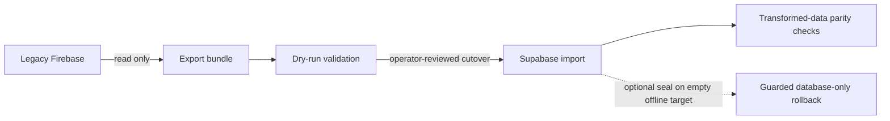

# Firebase → Supabase migration tools

Optional tooling for importing historical Noted data. **Fresh Supabase installations do not need this migration.** For normal setup, use the [backend guide](../../docs/SUPABASE_SETUP_AND_CUTOVER.md).

The exporter reads Firebase. Import, parity validation, and guarded rollback target Supabase. The four commands have different effects:



## Start with the safety boundary

| Operation | Reads | Writes |
|---|---|---|
| `export_firebase.mjs` | Firebase Auth, Firestore, Storage | Local bundle files only |
| `import_supabase.mjs --dry-run` | Bundle; target mapping ledger if target credentials are supplied | None |
| `import_supabase.mjs` | Bundle and target mapping state | Supabase Auth, application tables, Storage, migration ledger |
| `validate_migration.mjs` | Bundle and target Auth/database/media | None |
| `rollback_supabase.mjs --dry-run` | Locked target state and rollback seal | No deletion |
| `rollback_supabase.mjs --confirm-rollback` | Locked target state and rollback seal | Eligible migrated database rows only; retains Auth/profiles/settings/Storage |

Import is a multi-request operation, not an atomic transaction. Plan an offline cutover window and a verified backup. Inspect dry-run output and validate the final target before allowing native user activity.

## Prerequisites

- **Node.js 22+** and the committed package lockfile.
- The [matching Noted schema/RPCs](../../supabase/migrations/) on the target Supabase project.
- Firebase read-only credentials for export: Authentication Viewer, Cloud Datastore Viewer, and Storage Object Viewer permissions appropriate to the source.
- A private server-side Supabase service-role key for live target operations. Never use it in Flutter, source control, command examples with real values, or shared logs.

From the repository root:

```powershell
Set-Location tools/migration
npm ci
```

All commands below run from this directory. `exports/` is ignored by Git; bundles contain account data and private media and should be stored and handled privately.

## 1. Export the source, without changing it

```powershell
node export_firebase.mjs --project LEGACY_PROJECT_ID --service-account C:/private/firebase-readonly.json --include-media --out ./exports/bundle
```

`GOOGLE_APPLICATION_CREDENTIALS` can supply the credential path instead of `--service-account`. The exporter reads the actual legacy paths, including `connectionRequests` and `users/{uid}/settings/preferences`, and emits the normalized bundle layout consumed by the importer. Export includes Auth users, notes/roles/sharing, connections, favorites, preferences, invitations, activity, chats/messages, and optional media.

Missing or invalid credentials stop export with a blocker report. The exporter does not create synthetic replacement data or mutate Firebase. Keep the original bundle immutable so resumed imports and parity checks use the same source.

## 2. Review a write-free import preview

```powershell
node import_supabase.mjs --bundle ./exports/bundle --dry-run
```

Without target credentials this checks the bundle offline. If `SUPABASE_URL` and `SUPABASE_SERVICE_ROLE_KEY` are present, it can read target mappings to preview idempotency; it still performs no writes. Review warnings, orphans, account-state differences, content/media rewrites, and mapping counts before a live import.

## 3. Import into the reviewed target

Provide credentials through a private environment or a separate, untracked environment file. Node's `--env-file` avoids placing a real service key in a command argument. For example, keep `C:/private/noted-migration.env` outside this repository, containing `SUPABASE_URL` and `SUPABASE_SERVICE_ROLE_KEY`.

```powershell
node --env-file=C:/private/noted-migration.env import_supabase.mjs --bundle ./exports/bundle
```

Do not point this command at an environment until its target, backup, and cutover window are reviewed. The tools also accept `--supabase-url` and `--service-role-key`, but environment-based credentials keep real keys out of shell command history.

### What is preserved

| Source property | Target behavior |
|---|---|
| Firebase user ID | Deterministic UUIDv5; original UID retained in `profiles.legacy_firebase_uid` |
| Note ID and note links | Original `note_id` retained, including legacy non-UUID IDs |
| Rich text and legacy Markdown | Content preserved; matched attachment URLs rewritten to stable private media references |
| Membership and sharing | User IDs mapped consistently; edit/view roles and copy provenance retained |
| Favorites, settings, activity, chats | Transformed with their ownership and relationships |
| Avatars and attachments | Private `avatars` / `note-media` buckets; media parity checks include SHA-256 |
| Verified email flag | Only verified source email addresses are confirmed |
| Disabled account flag | Target account banned for 100 years; this finite ban needs lifecycle management |
| Repeat execution | Entity checksums and mapping ledger skip unchanged imported rows |

Firebase password hashes are not imported as usable Supabase passwords by this implementation. Plan a verified account-recovery flow for enabled users; the importer sends no automatic invitation. Missing verification flags are treated as unverified. An already-confirmed target account cannot be unconfirmed through the Admin API, so a source-unverified mismatch blocks for manual resolution. Disabled source users are banned even when that mismatch blocks import.

Idempotency supports resume; it is not a substitute for backups or permission to overwrite activity after cutover.

## 4. Validate the actual target

```powershell
node --env-file=C:/private/noted-migration.env validate_migration.mjs --bundle ./exports/bundle
```

Validation compares target data against the **transformed source**, including exact identities/counts, account confirmation/ban state, ownership, note content, role and sharing arrays, favorites, connections, copy provenance, AI sources, and downloaded media checksums. Skipped source orphans fail validation. Timestamps are compared when provided; absent source timestamps cannot independently reproduce generated values.

Inspect every failed check. A successful command means the implemented parity checks passed; it does not prove physical-device flows or email delivery.

## 5. Understand the rollback limit

Rollback is deliberately **database-only**. It retains Auth users, profiles, settings, and all Storage blobs. Complete environment recovery requires a separately reviewed backup/restore procedure.

A new import into an **entirely empty target kept offline** may opt in to a rollback seal:

```powershell
node --env-file=C:/private/noted-migration.env import_supabase.mjs --bundle ./exports/bundle --seal-rollback
```

The importer captures a locked database snapshot, validates the exact rows against the source bundle, and passes that same snapshot to the seal RPC. The RPC rejects intervening changes. Later native activity, unexpected dependencies, changed state, and old unsealed ledgers block rollback. Sealing does not make the multi-request import atomic.

Preview first. Only execute deletion after the result and retained data are understood:

```powershell
node --env-file=C:/private/noted-migration.env rollback_supabase.mjs --dry-run
node --env-file=C:/private/noted-migration.env rollback_supabase.mjs --confirm-rollback
```

Preflight and eligible database deletion share a locked transaction. These commands are not a way to clear a populated live environment.

## Verify the tooling

```powershell
# Full backend/RLS/Edge/migration regression suite: currently 89 tests
npm test

# Focused original migration workflow suite
npm run test:migration
```

The full suite includes the later migration regression files; the focused script is a subset. PGlite and controlled SDK/handler fixtures exercise transformations, access rules, account states, idempotency, parity, and rollback without production credentials. They do not connect to the real legacy Firebase project.

## Related documentation

- [Project overview and app setup](../../README.md)
- [Backend overview](../../supabase/README.md)
- [Setup, cutover, deployment, and release gates](../../docs/SUPABASE_SETUP_AND_CUTOVER.md)
- [Combined review findings and evidence](../../docs/FULL_CHANGE_REVIEW.md)
- [Historical migration plan](../../docs/SUPABASE_MIGRATION_PLAN.md)
